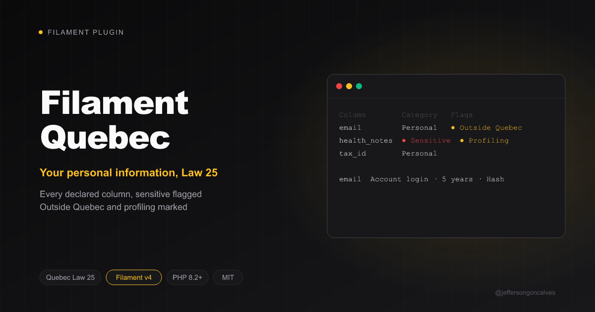

<div class="filament-hidden">



</div>

# Filament Quebec

[](https://packagist.org/packages/jeffersongoncalves/filament-quebec)
[](https://github.com/jeffersongoncalves/filament-quebec/actions?query=workflow%3Atests+branch%3A2.x)
[](https://github.com/jeffersongoncalves/filament-quebec/actions?query=workflow%3A"Fix+PHP+code+styling"+branch%3A2.x)
[](https://packagist.org/packages/jeffersongoncalves/filament-quebec)
[](LICENSE.md)

A personal information inventory page for your Filament panel, built on [laravel-quebec](https://github.com/jeffersongoncalves/laravel-quebec). It lists every column you declared with `#[PersonalData]`, grouped by model, with its category, purpose, flags, retention and destruction strategy, under Quebec's private sector privacy act (Law 25). It is the starting point of your inventory of processing activities.

## Features

- One card per model in `quebec.models`, one row per declared column.
- Sensitive information (s. 12) highlighted.
- Columns communicated outside Quebec (s. 17) or used for profiling (s. 8.1) flagged.
- Columns without a purpose (s. 8) flagged as "Not declared".
- 19 languages.

## Compatibility

| Plugin Version                                                      | Filament |
|---------------------------------------------------------------------|----------|
| [1.x](https://github.com/jeffersongoncalves/filament-quebec/tree/1.x) | 3.x      |
| [2.x](https://github.com/jeffersongoncalves/filament-quebec/tree/2.x) | 4.x      |
| [3.x](https://github.com/jeffersongoncalves/filament-quebec/tree/3.x) | 5.x      |

## Installation

You can install the package via composer:

```bash
composer require jeffersongoncalves/filament-quebec:"^2.0"
```

Declare your personal data and register the models as described in [laravel-quebec](https://github.com/jeffersongoncalves/laravel-quebec#usage).

## Usage

```php
use JeffersonGoncalves\Filament\Quebec\QuebecPlugin;

public function panel(Panel $panel): Panel
{
    return $panel
        ->plugins([
            QuebecPlugin::make()
                ->navigationGroup('Quebec')             // default: no group
                ->navigationSort(1)
                ->navigationIcon('heroicon-o-finger-print')
                ->slug('personal-data-inventory'),
        ]);
}
```

All fluent methods are optional. The page is read-only: the inventory lives in your code, next to the models.

> The page has no authorization of its own: register it only on panels whose users may see it, or override `canAccess()` in a subclass.

## Related plugins

- [filament-quebec-requests](https://github.com/jeffersongoncalves/filament-quebec-requests): access, rectification, de-indexation and portability requests (ss. 27 to 32).

## Testing

```bash
composer test
```

## Changelog

Please see [CHANGELOG](CHANGELOG.md) for more information on what has changed recently.

## Contributing

Please see [CONTRIBUTING](.github/CONTRIBUTING.md) for details.

## Security Vulnerabilities

Please review [our security policy](../../security/policy) on how to report security vulnerabilities.

## Credits

- [Jefferson Gonçalves](https://github.com/jeffersongoncalves)
- [All Contributors](../../contributors)

## License

The MIT License (MIT). Please see [License File](LICENSE.md) for more information.
